# Лабораторна робота 02. Налаштування середовища розробки та Git workflow

**ПІБ:** Хомич Максим Віталійович
**Група:** ІПЗ-22
**Роль у команді:** team lead, developer
**Репозиторій:** [https://github.com/Maksimka111222/password-generator](https://github.com/Maksimka111222/password-generator)

## Команда

| Учасник | GitHub | Роль | Модуль |
|---|---|---|---|
| Maksym Khomych | @Maksimka111222 | team lead, developer | CLI (`src/cli.py`), CHANGELOG, реліз |
| Diana Zhuk | @dirolssis | developer | генератор паролів (`src/generator.py`), виправлення помилки |
| Volodymyr Sienko | @VEivon | developer, QA | перевірка надійності пароля (`src/strength.py`), unit-тести |

Проєкт: консольна утиліта для генерації паролів з налаштовуваною довжиною та наборами символів.

## Особистий внесок

### Гілки

Гілки видалялися після злиття, тому посилання ведуть на Pull Request кожної гілки.

- `feature/cli` (CLI-інтерфейс), [PR #12](https://github.com/Maksimka111222/password-generator/pull/12)
- `docs/changelog` (CHANGELOG), [PR #18](https://github.com/Maksimka111222/password-generator/pull/18)
- `feature/readme-lead` (оновлення рядка команди в README), [PR #16](https://github.com/Maksimka111222/password-generator/pull/16)
- `docs/readme-format` (структура README), [PR #19](https://github.com/Maksimka111222/password-generator/pull/19)
- `docs/readme-team` (імена учасників у README), [PR #20](https://github.com/Maksimka111222/password-generator/pull/20)
- [`docs/report-maksym`](https://github.com/Maksimka111222/password-generator/tree/docs/report-maksym) (цей звіт)

Як team lead я створив репозиторій, додав учасників як collaborators, налаштував `.gitignore`, розподілив завдання та створив Issues #5–#9.

### Pull Request
- [#12 feat: CLI interface](https://github.com/Maksimka111222/password-generator/pull/12), Merged
- [#18 docs: add CHANGELOG](https://github.com/Maksimka111222/password-generator/pull/18), Merged
- [#16 Team: Maksym Khomych - team lead, developer](https://github.com/Maksimka111222/password-generator/pull/16), Merged
- [#19 docs: improve README structure](https://github.com/Maksimka111222/password-generator/pull/19), Merged
- [#20 docs: add team members to README](https://github.com/Maksimka111222/password-generator/pull/20), Merged
- Review: [#11 feat: password strength checker](https://github.com/Maksimka111222/password-generator/pull/11), Approved

### Коміти
- `fa61392` Merge pull request #18 from Maksimka111222/docs/changelog, на ньому стоїть тег `v1.0.0` ([посилання](https://github.com/Maksimka111222/password-generator/commit/fa61392))
- [`a1a0d3a`](https://github.com/Maksimka111222/password-generator/commit/a1a0d3a) feat: add CLI interface
- [`ffe02d2`](https://github.com/Maksimka111222/password-generator/commit/ffe02d2) docs: add CHANGELOG for v1.0.0
- [`937221a`](https://github.com/Maksimka111222/password-generator/commit/937221a) docs: improve README structure

## Конфлікт злиття

Конфлікт виник у файлі `README.md`: я й Diana Zhuk незалежно змінили рядок `Team:` у різних гілках (`feature/readme-lead` і `feature/readme-team`). Я злив свій PR першим, тому PR Diana (#17) отримав конфлікт із `main`. Вона виконала `git merge origin/main`, відкрила README у VS Code, де Git позначив блок маркерами `<<<<<<<`, `=======` і `>>>>>>>`, залишила один рядок, видалила маркери, зробила `git add` і коміт, після чого PR було злито.

Окремий конфлікт виник і в мене локально: після `git pull` гілки `main` розійшлися, бо один мій коміт не потрапив через PR. Я скасував злиття командою `git merge --abort` і вирівняв `main` з `origin/main` через `git reset --hard origin/main`. Для скріншотів я додатково відтворив конфлікт у навчальних гілках `demo/conflict-a` та `demo/conflict-b` і не відправляв їх на GitHub. Висновок: коміти слід робити лише в окремих гілках, а `main` змінювати тільки через Pull Request.

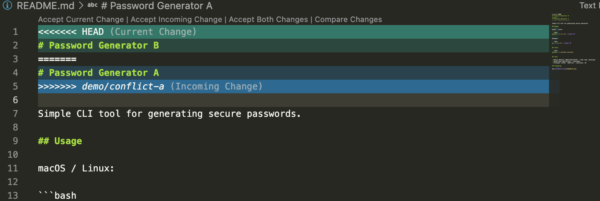
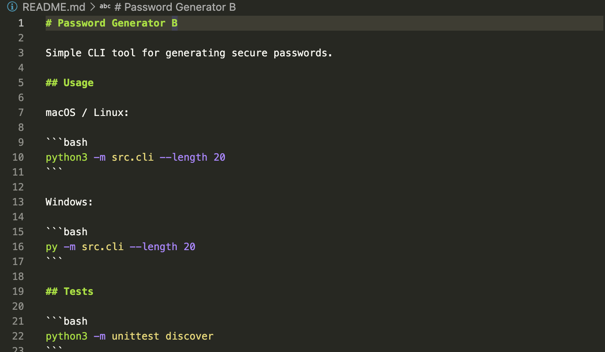

## Робота у VS Code

Коміт звіту, зміни у вкладці Source Control і перемикання гілки я виконав через VS Code.

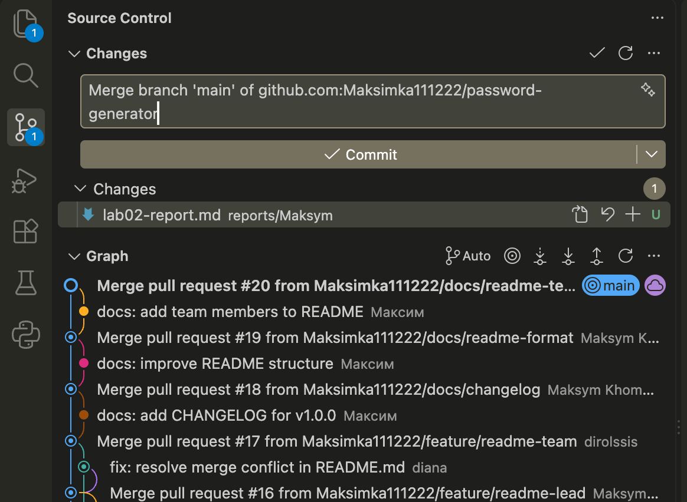
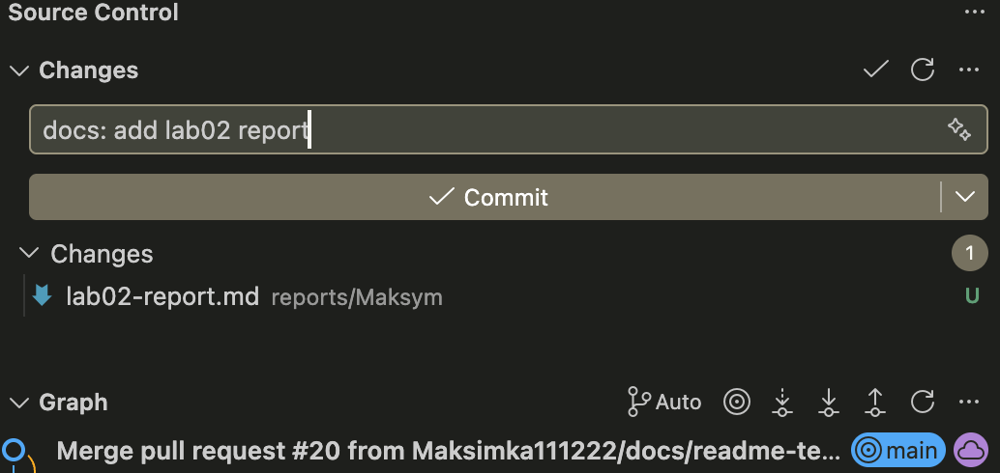
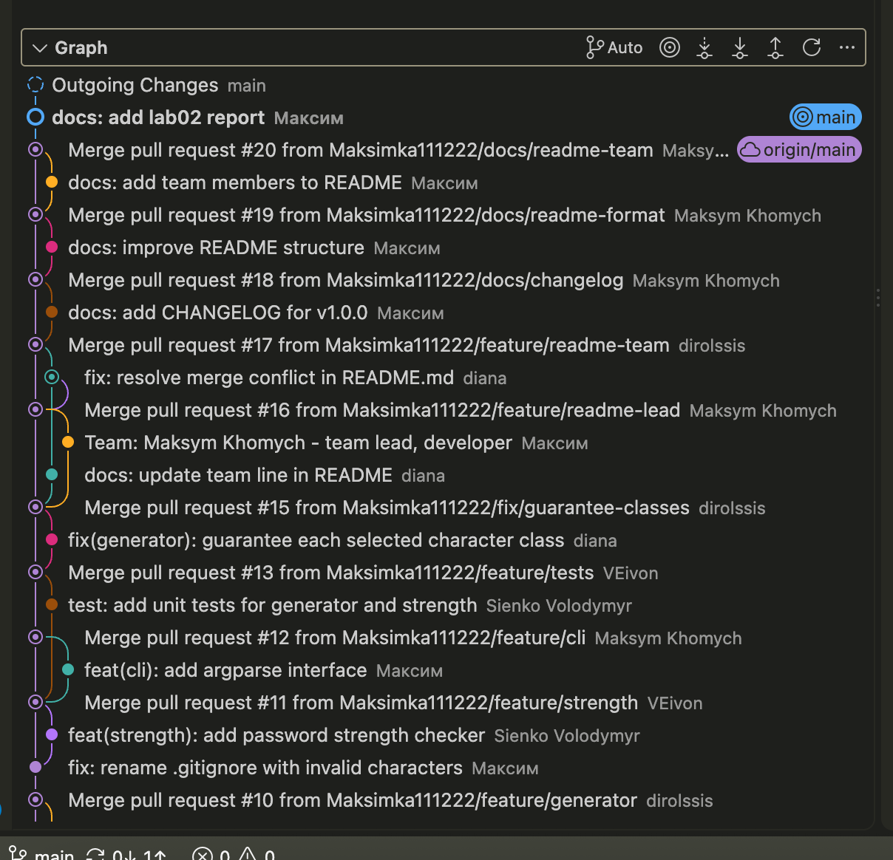

## Issues і реліз

- Issue [#7 feat: CLI interface](https://github.com/Maksimka111222/password-generator/issues/7), виконаний у PR #12
- Issue [#5 feat: password generator core](https://github.com/Maksimka111222/password-generator/issues/5), закритий автоматично через PR #18 (`Closes #5`)
- Issue [#9 docs: README, CHANGELOG, reports](https://github.com/Maksimka111222/password-generator/issues/9), закривається PR з цим звітом (`Closes #9`)
- Issue [#14 fix: generator does not guarantee each character class](https://github.com/Maksimka111222/password-generator/issues/14), закритий PR #15 (автор виправлення Diana Zhuk)
- Реліз: [https://github.com/Maksimka111222/password-generator/releases/tag/v1.0.0](https://github.com/Maksimka111222/password-generator/releases/tag/v1.0.0). Тег `v1.0.0` стоїть на коміті `fa61392`, опис релізу взято з `CHANGELOG.md`.

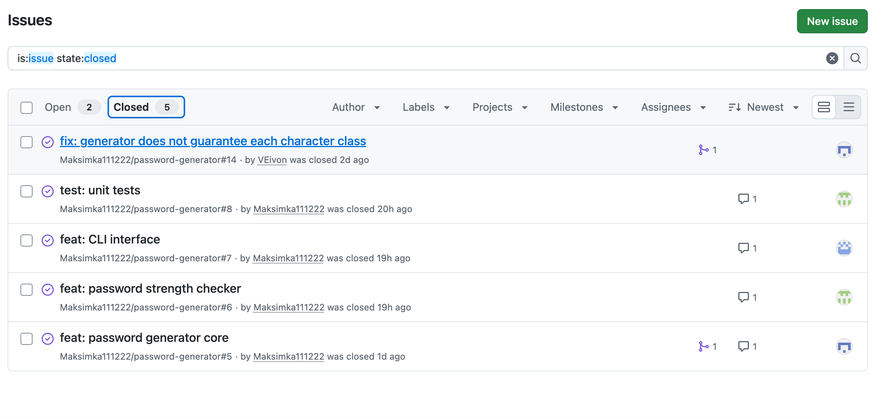
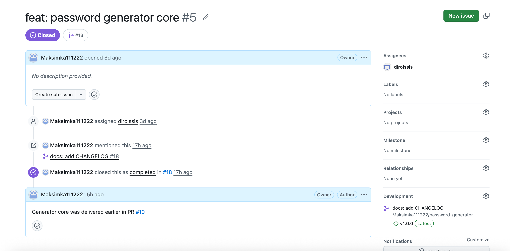
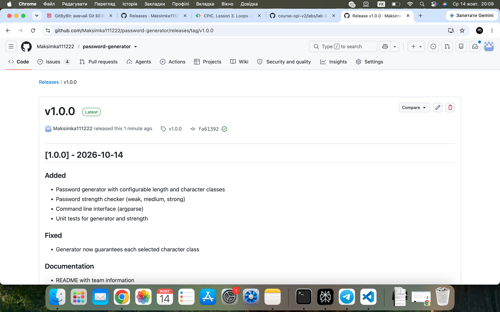

## Результати перевірки

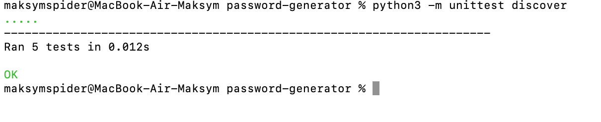
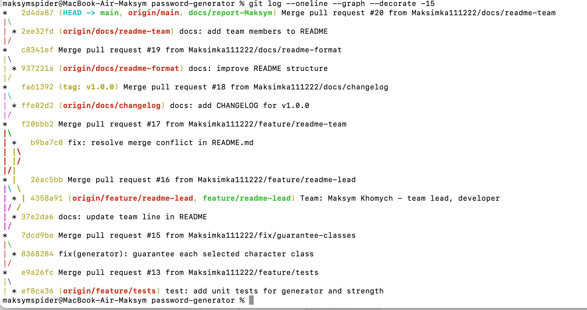
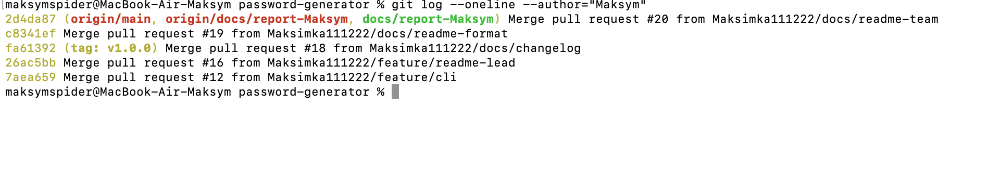
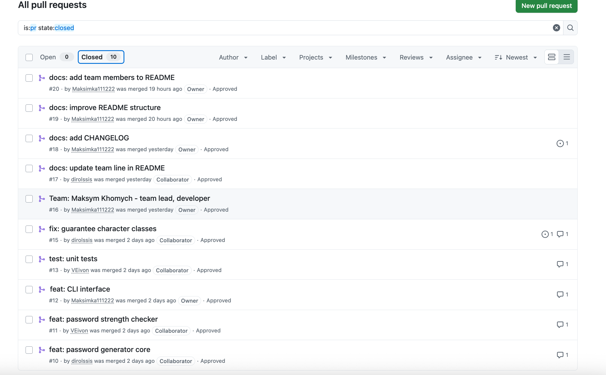
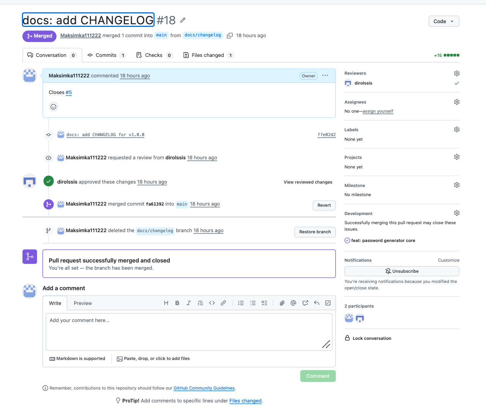

## Висновки

Я навчився працювати за Feature Branch Workflow: кожна зміна йде в окремій гілці, потрібен Pull Request з review, а Issues закриваються автоматично через `Closes #N`. Також я пройшов повний цикл випуску: CHANGELOG, тег `v1.0.0` і GitHub Release. Найскладнішим було розібратися зі станом merge та розбіжністю `main` з `origin/main`, де допомогли `git merge --abort` і `git reset --hard origin/main`.