# Лабораторна робота 02. Налаштування середовища розробки та Git workflow

ПІБ: Сієнко Володимир Павлович
Група: ІПЗ-22
Роль у команді: developer, QA
Репозиторій: [https://github.com/Maksimka111222/password-generator](https://github.com/Maksimka111222/password-generator)

## Команда

| Учасник | GitHub | Роль | Модуль |
|---|---|---|---|
| Maksym Khomych | @Maksimka111222 | team lead, developer | CLI (`src/cli.py`), CHANGELOG, реліз |
| Diana Zhuk | @dirolssis | developer | генератор паролів (`src/generator.py`), виправлення помилки |
| Volodymyr Sienko | @VEivon | developer, QA | перевірка надійності пароля (`src/strength.py`), unit-тести |

Проєкт: консольна утиліта для генерації паролів з налаштовуваною довжиною та наборами символів.

## Особистий внесок

### Гілки

Гілки видалялися після злиття, тому посилання ведуть на Pull Request кожної гілки.

- feature/strength (перевірка надійності пароля), [PR #11](https://github.com/Maksimka111222/password-generator/pull/11)
- feature/tests (unit-тести), [PR #13](https://github.com/Maksimka111222/password-generator/pull/13)
- docs/report-Volodymyr (цей звіт)

Я реалізував модуль перевірки надійності пароля, потім написав unit-тести для генератора й перевірки надійності. Тести запускав на Windows у Git Bash командою py -m unittest discover. Як QA знайшов помилку в генераторі й описав її в Issue #14.

### Pull Request

Мої PR:
- [#11](https://github.com/Maksimka111222/password-generator/pull/11) feat: password strength checker, Merged
- [#13](https://github.com/Maksimka111222/password-generator/pull/13) test: unit tests, Merged

Review (Approved):
- [#10](https://github.com/Maksimka111222/password-generator/pull/10) feat: password generator core
- [#15](https://github.com/Maksimka111222/password-generator/pull/15) fix: guarantee character classes
- [#16](https://github.com/Maksimka111222/password-generator/pull/16) Team: Maksym Khomych - team lead, developer
- [#17](https://github.com/Maksimka111222/password-generator/pull/17) docs: update team line in README
- [#22](https://github.com/Maksimka111222/password-generator/pull/22) docs: add lab02 report by Maksym

### Коміти

- [`fa8cf5f`](https://github.com/Maksimka111222/password-generator/commit/fa8cf5f) feat(strength): add password strength checker
- [`ef8ca36`](https://github.com/Maksimka111222/password-generator/commit/ef8ca36) test: add unit tests for generator and strength

## Конфлікт злиття

Я створив дві гілки, у яких змінив перший рядок файлу README.md по-різному, і злив їх. Git зупинив злиття й позначив конфліктну ділянку маркерами <<<<<<<, =======, >>>>>>>. У VS Code я обрав Accept Both Changes, зберіг файл і зробив коміт. Скріншоти зроблено на тренувальному відтворенні конфлікту.

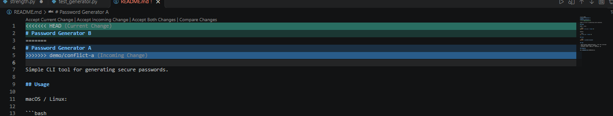
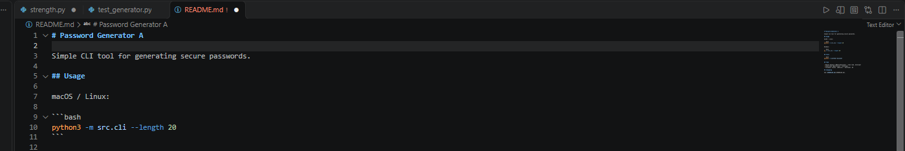

## Робота у VS Code

Коміт, зміни у вкладці Source Control і перемикання гілки я виконав через VS Code.

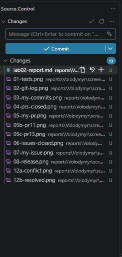
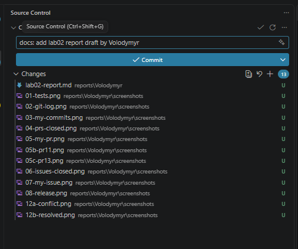
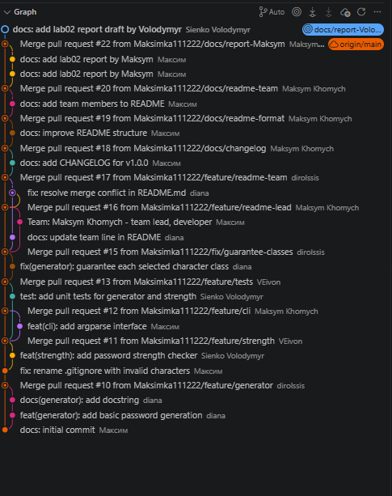

## Issues і реліз

- Issue [#14](https://github.com/Maksimka111222/password-generator/issues/14) fix: generator does not guarantee each character class, створений мною, закритий PR #15
- Issue [#23](https://github.com/Maksimka111222/password-generator/issues/23) docs: lab02 report by Volodymyr, закритий через PR зі звітом (`Closes #23`)
- Реліз: [https://github.com/Maksimka111222/password-generator/releases/tag/v1.0.0](https://github.com/Maksimka111222/password-generator/releases/tag/v1.0.0). Тег v1.0.0 стоїть на коміті fa61392.

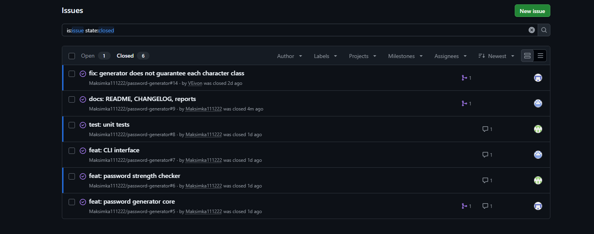
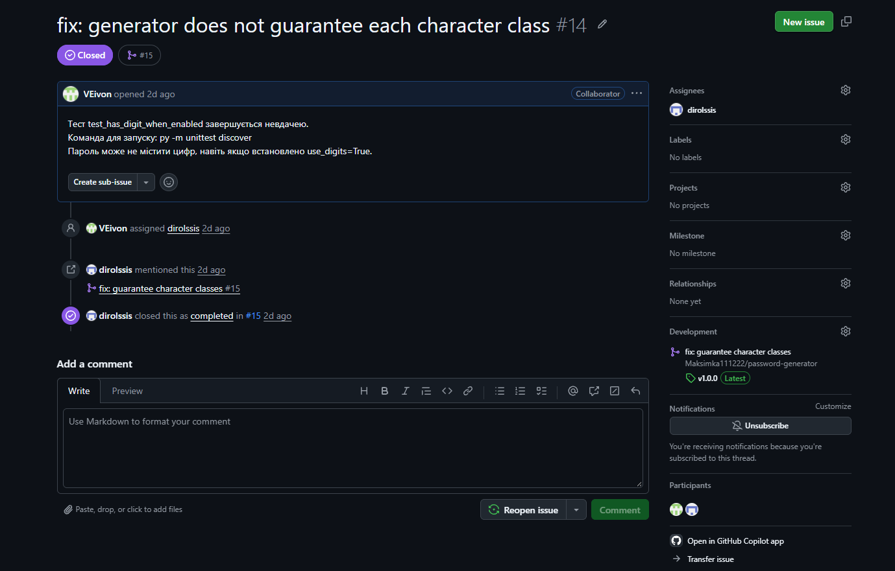
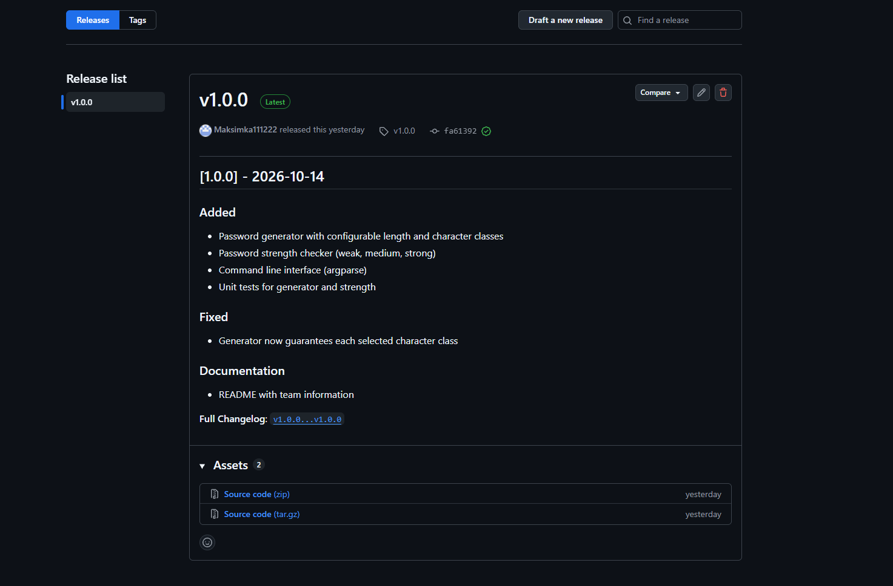

## Результати перевірки
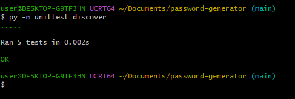
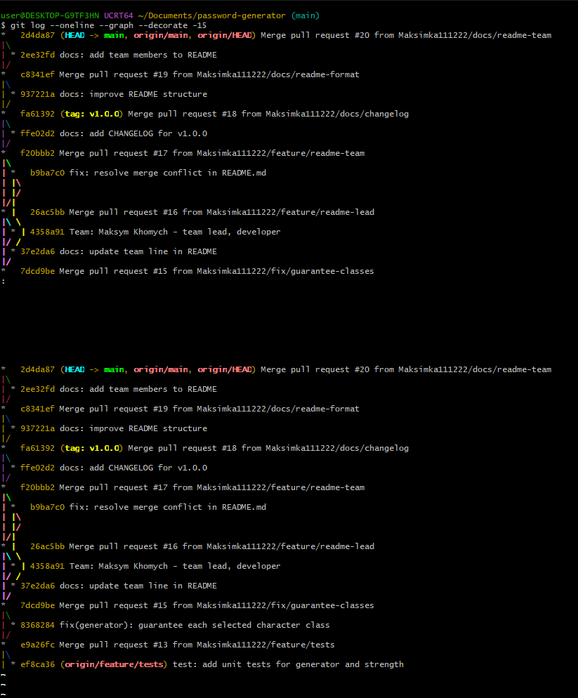
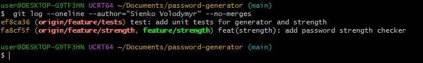
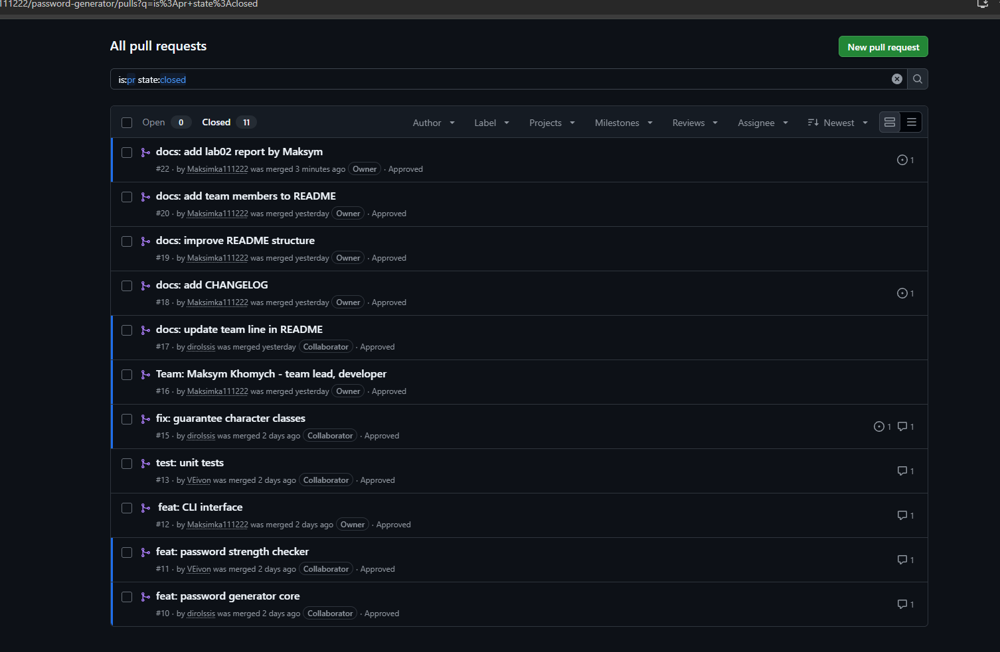
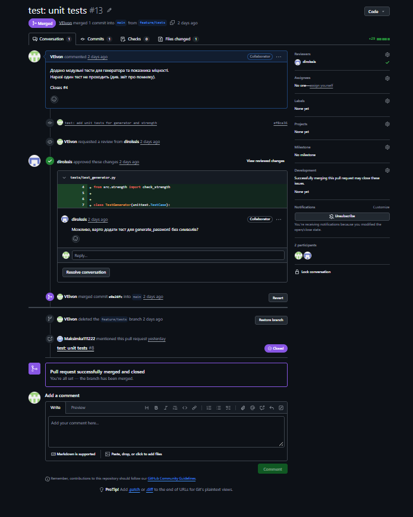
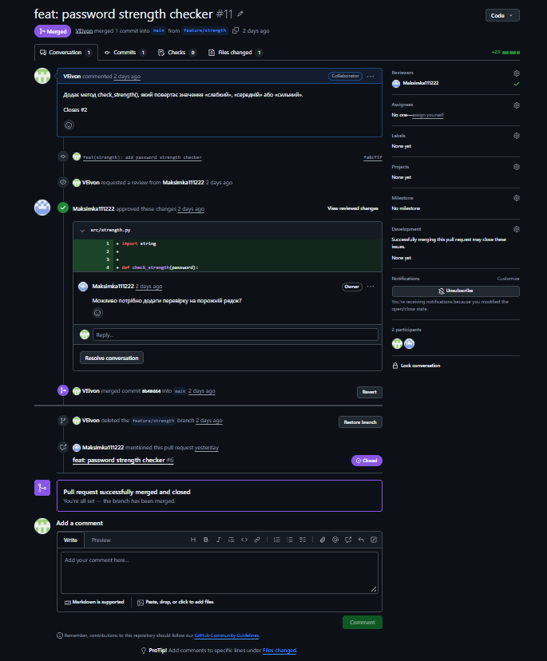

## Висновки

Я навчився працювати з гілками, Pull Request і code review, а також писати unit-тести для модулів проєкту. Найскладнішим було налаштувати запуск тестів на Windows і розібратися з Git Bash. Робота в команді за GitHub Flow показала, чому зміни йдуть через окремі гілки та перевірку.