# Лабораторна робота 02. Налаштування середовища розробки та Git workflow

ПІБ: Жук Діана Валеріївна
Група: ІПЗ-22
Роль у команді: developer
Репозиторій: [https://github.com/Maksimka111222/password-generator](https://github.com/Maksimka111222/password-generator)

## Команда

| Учасник | GitHub | Роль | Модуль |
|---|---|---|---|
| Maksym Khomych | @Maksimka111222 | team lead, developer | CLI (`src/cli.py`), CHANGELOG, реліз |
| Diana Zhuk | @dirolssis | developer | генератор паролів (`src/generator.py`), виправлення помилки |
| Volodymyr Sienko | @VEivon | developer, QA | перевірка надійності пароля (`src/strength.py`), unit-тести |

Проєкт: консольна утиліта для генерації паролів з налаштовуваною довжиною та наборами символів.

## Особистий внесок

### Гілки

Гілки видалялися після злиття, тому посилання ведуть на Pull Request кожної гілки.

- feature/generator (базова генерація паролів і docstring), [PR #10](https://github.com/Maksimka111222/password-generator/pull/10)
- fix/guarantee-classes (гарантія кожного обраного класу символів), [PR #15](https://github.com/Maksimka111222/password-generator/pull/15)
- feature/readme-team (рядок команди в README), [PR #17](https://github.com/Maksimka111222/password-generator/pull/17)
- docs/report-Diana (цей звіт)

Я реалізувала модуль генерації паролів: базову генерацію та docstring. Згодом виправила помилку з Issue #14, яку знайшов QA: пароль міг не містити символів деяких обраних класів, а тепер кожен вибраний клас гарантовано присутній. Також додала в README рядок про команду.

### Pull Request

Мої PR:
- [#10](https://github.com/Maksimka111222/password-generator/pull/10) feat: password generator core, Merged
- [#15](https://github.com/Maksimka111222/password-generator/pull/15) fix: guarantee character classes, Merged
- [#17](https://github.com/Maksimka111222/password-generator/pull/17) docs: update team line in README, Merged

Review (Approved):
- [#12](https://github.com/Maksimka111222/password-generator/pull/12) feat: CLI interface
- [#13](https://github.com/Maksimka111222/password-generator/pull/13) test: unit tests
- [#18](https://github.com/Maksimka111222/password-generator/pull/18) docs: add CHANGELOG
- [#19](https://github.com/Maksimka111222/password-generator/pull/19) docs: improve README structure
- [#20](https://github.com/Maksimka111222/password-generator/pull/20) docs: add team members to README

### Коміти

- [`4b2c811`](https://github.com/Maksimka111222/password-generator/commit/4b2c811) feat(generator): add basic password generation
- [`11f713e`](https://github.com/Maksimka111222/password-generator/commit/11f713e) docs(generator): add docstring
- [`8368284`](https://github.com/Maksimka111222/password-generator/commit/8368284) fix(generator): guarantee each selected character class
- [`37e2da6`](https://github.com/Maksimka111222/password-generator/commit/37e2da6) docs: update team line in README

## Конфлікт злиття

Конфлікт виник під час роботи над PR #17: у якому файлі, між якими гілками, і який рядок змінили обидві сторони. Git зупинив злиття й позначив конфліктну ділянку маркерами <<<<<<<, =======, >>>>>>>. У VS Code я обрала Accept Both Changes, зберегла файл і зробила коміт. Після цього перевірила git status і запустила тести, вони пройшли.

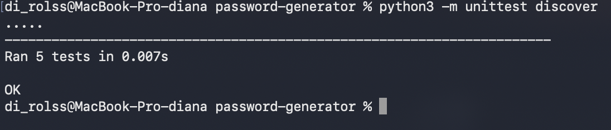

## Робота у VS Code

Коміт, зміни у вкладці Source Control і перемикання гілки я виконала через VS Code.

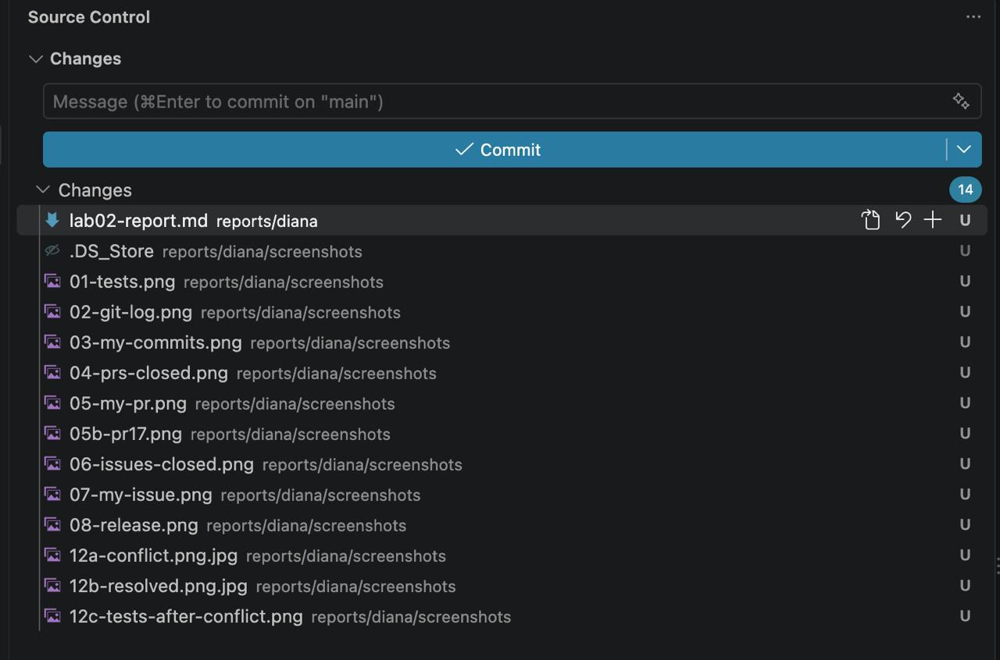
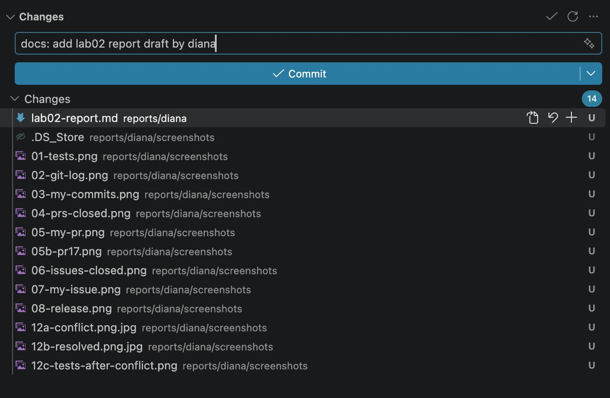
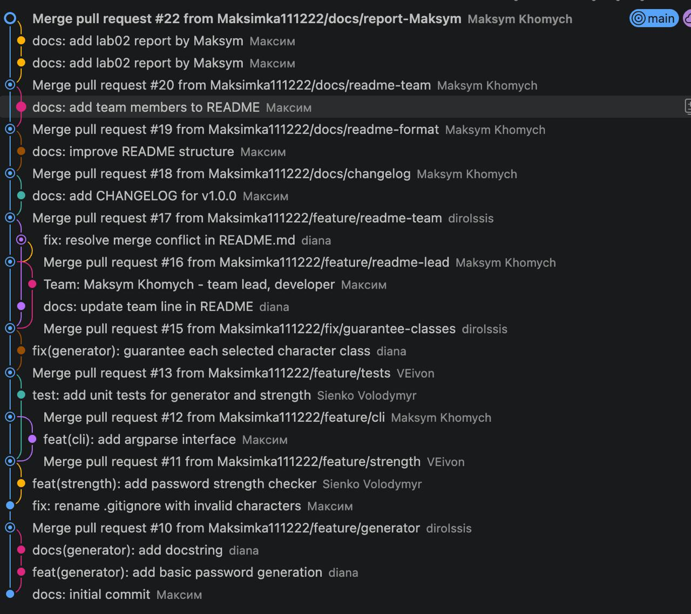

## Issues і реліз
- Issue [#14](https://github.com/Maksimka111222/password-generator/issues/14) fix: generator does not guarantee each character class, створений QA (Volodymyr), закритий моїм PR #15
- Issue [#21](https://github.com/Maksimka111222/password-generator/issues/21) docs: lab02 report by Diana, закритий через PR зі звітом (`Closes #21`)
- Реліз: [https://github.com/Maksimka111222/password-generator/releases/tag/v1.0.0](https://github.com/Maksimka111222/password-generator/releases/tag/v1.0.0). Тег v1.0.0 стоїть на коміті fa61392.

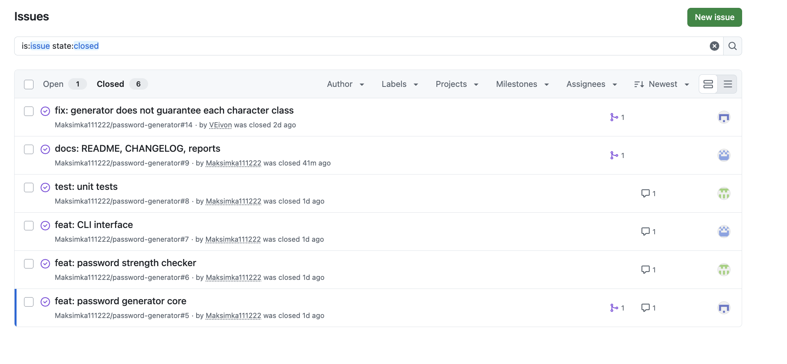
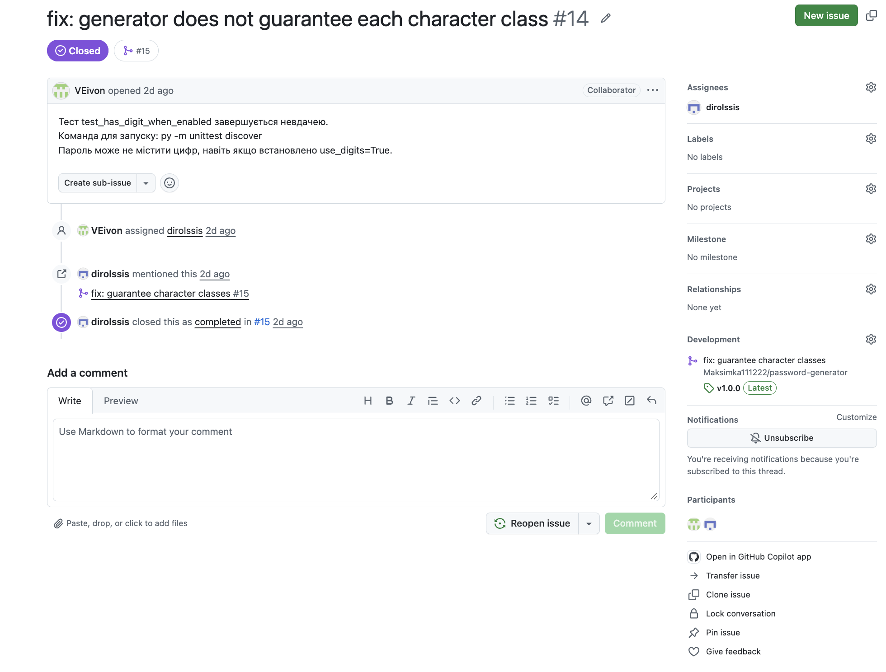
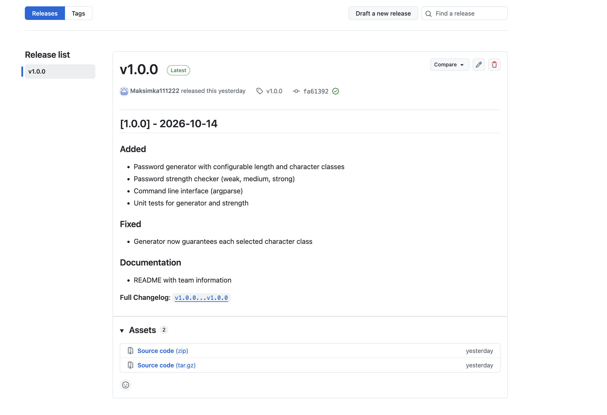

## Результати перевірки

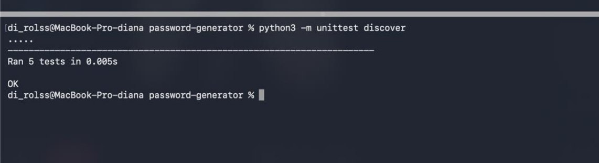
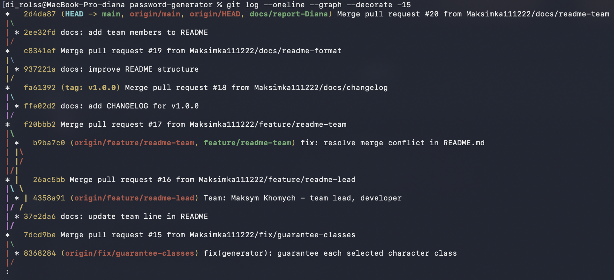
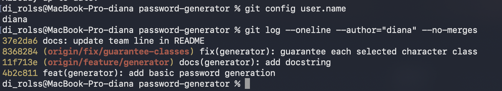
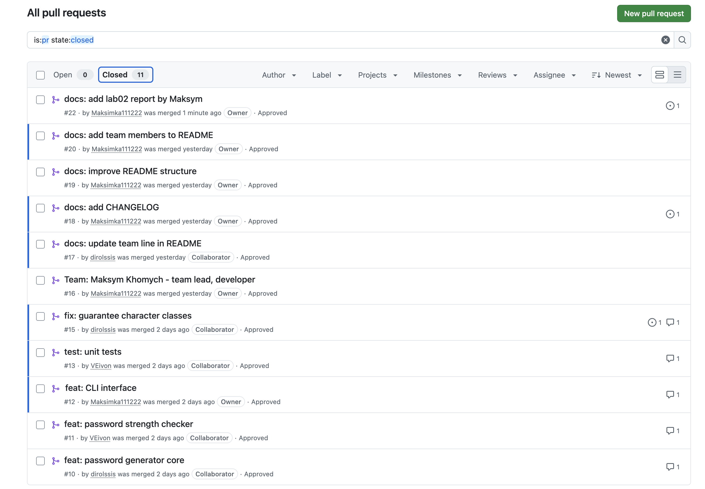
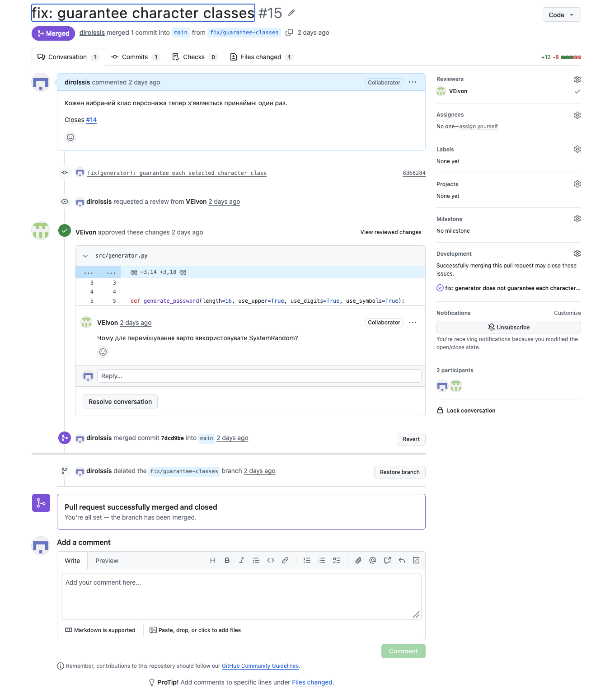
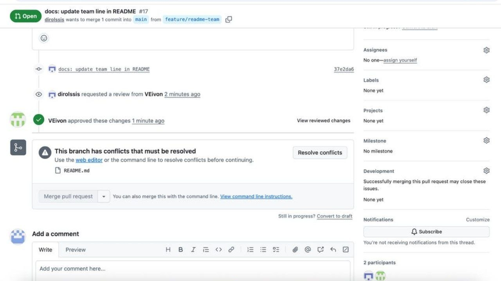

## Висновки

Я навчилася працювати з гілками, Pull Request і code review, а також розв'язувати конфлікти злиття у VS Code. Найскладнішим було розібратися, як узгоджувати зміни в одному файлі між кількома гілками. Практика з Issue, PR і релізом допомогла зрозуміти, як команда працює над проєктом за GitHub Flow.